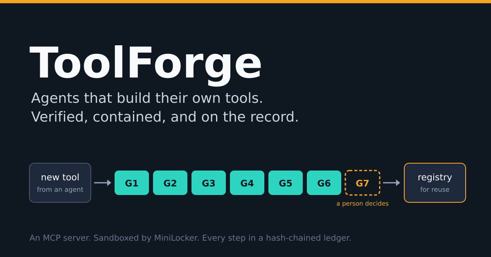

# ToolForge

**An MCP server that lets an AI agent build, verify and reuse its own tools, safely.**

Agents get stuck the moment a task needs a capability they were not given: a file format nobody wrote a parser for, a database they have no
query tool for, a program they cannot drive. ToolForge closes that gap. When an agent has no tool for the job, it asks ToolForge to forge one.
The tool is written, tested, attacked and measured, and only then published into a registry where this agent, and any other MCP client, can
find and reuse it. A person, never the agent, decides what becomes usable. Every tool runs inside a hardened sandbox, always, with exactly the
permissions its manifest declares, and every step lands on a tamper-evident ledger.



## How it works

```
 any MCP client (Claude Desktop, an IDE, your own agent)
        |  MCP (stdio, or HTTP with a bearer token)
        v
 +---------------------------+        +---------------------------------------------+
 |  ToolForge MCP server     |        |  MiniLocker (pinned dependency)             |
 |  find / describe / run    |  uses  |  hardened Docker sandboxes, egress proxy,   |
 |  submit / build / repair  +------->|  credential broker, decoys, hash-chained    |
 |                           |        |  ledger, Blast Radius report                |
 |  verification pipeline    |        +---------------------------------------------+
 |  G1..G7 gates             |
 |  registry (SQLite + blobs)|
 +---------------------------+
```

* **Forge:** the agent submits a tool package (code, tests, manifest) or asks the server to build one from a goal.
* **Verify:** seven gates (static checks, build, self-tests, schema fuzzing, an independent challenger, containment probing, approval) decide
  whether the tool is published. A gate that could not run says so; it is never counted as a pass.
* **Run:** tools execute only in a fresh MiniLocker sandbox, with the network closed unless an operator approved exact hosts.
* **Reuse and repair:** tools are versioned, searchable, scored by real outcomes, repaired through the same gates, and rolled back when needed.

The full picture, with the trust boundaries and the tool lifecycle, is in [docs/ARCHITECTURE.md](docs/ARCHITECTURE.md). A short summary is in
[docs/PROJECT_SUMMARY.md](docs/PROJECT_SUMMARY.md).

## Quick start

You need Python 3.12 and Docker. On Windows, work inside WSL2 (`docs/guide/06-wsl2-setup.md`). Unit tests need no Docker; real sandboxes do.

```
git clone --recurse-submodules <this repository>
cd toolforge
python3 -m venv .venv && . .venv/bin/activate
pip install -e ".[dev,sandbox]"
toolforge images build        # the image tool sandboxes run in, once
toolforge doctor              # checks Python, Docker, the image and the MiniLocker checkout
toolforge serve               # the MCP server on stdio
```

A tool an agent submits is verified but not usable until you say so. With no model configured, the path is: submit, read the report, promote.

```
toolforge submit examples/toolpacks/csv_summary
toolforge promote csv_summary@1.0.0 --reason "reference tool, read it first"
```

No API key is needed to begin. A language model is needed only for the challenger gate (G5), the server-side builder, the benchmark and the
live demo (`docs/guide/04-optional-resources.md`; every resource there is optional).

## Run it with Docker Compose

```
cp .env.example .env          # then set TOOLFORGE_SERVER_TOKEN and TOOLFORGE_DASHBOARD_TOKEN to long random values
make demo-up                  # or: docker compose up -d --build
```

The MCP server is at `http://127.0.0.1:8765/mcp` and the dashboard at `http://127.0.0.1:8787/`; both listen on loopback only and want their bearer
token. The containers never mount the Docker socket: they use a proxy that allows only the calls MiniLocker makes. Details, client configuration and
the security rules are in [docs/clients.md](docs/clients.md). This compose setup was written without a Docker daemon to try it on; the file and its
guards are tested, a full start has not been, and `PROGRESS.md` says what to check first.

## Connect an MCP client

After `toolforge submit <dir>` verifies a tool, the operator runs `toolforge promote <name>@<version> --reason "..."` to make it active.
`docs/clients.md` has the stdio and HTTP configuration for Claude Code and for any client that reads an MCP JSON file. How tools are ranked, described,
repaired and rolled back is in `docs/repair.md`. Handing a verified tool to another operator as a signed bundle (optional patch S01) is in
`docs/PROVENANCE.md`. The optional `forge_chain` tool (off unless `TOOLFORGE_CHAIN_ENABLED=true`, see `docs/CHAINS.md`) runs a short fixed list of
active tools in one call.

<!-- tools:begin -->
| Tool | Input | Returns | Since |
| --- | --- | --- | --- |
| `forge_find` | `query: str`, `limit: int = 5` | ranked active tools with `confidence`, a one-line `why`, `uses`, `success_rate` (or null) and permissions | P07 |
| `forge_describe` | `name: str`, `version: str | null` | the sanitised manifest, a typed call `signature`, examples, status, lineage and gate summaries | P07 |
| `forge_run` | `name: str`, `args: object`, `files: object | null`, `session_id: str | null` | the call result: `ok`, the fenced `output` or `error`, `stdout`, `stderr`, `flags`; for a session tool also `session_id`, `step` | P07 |
| `forge_submit` | `package: {manifest, files}` | the verification report: status, gates with summaries and hints, `next_action` | P07 |
| `forge_status` | `name: str`, `version: str | null` | status, `next_step`, gate summaries and approval state | P07 |
| `forge_list` | `status: str | null` | versions with name, version, status and a short description (capped) | P07 |
| `forge_recipe` | `kind: str` | the documentation text (a recipe per kind of tool; an unknown kind lists them) | P07 |
| `forge_runtime_info` | none | Python version, runtime image, sandbox limits, preinstalled libraries (or null: not measured) | P07 |
| `forge_build` | `goal: str`, `examples: [{input, output?}] | null`, `sample_files: object | null`, `constraints: str | null` | `reused` or the built `tool` and `version`, its `status`, `rounds`, `usage`, the verification `report` and `next_action` | P11 |
| `forge_repair` | `name: str`, `problem: str`, `package: {manifest, files} | null` | `ok`, the new `version` and its `status`, `rounds`, the verification `report` and `next_action` | P12 |
| `forge_report_problem` | `name: str`, `version: str | null`, `description: str` | `stored`, the report id and what happens next | P12 |
| `forge_session_close` | `session_id: str` | `closed`, the number of `steps`, the sandbox audit result and a one-line Blast Radius `verdict` | P13 |
| `forge_session_rewind` | `session_id: str`, `step: int` | the `step` it is at now and the `steps_available` that can still be restored | P13 |
| `forge_session_list` | `session_id: str | null` | open sessions by public name (tool, steps, time left); with your `session_id`, its `steps_available` too | P13 |
| `forge_chain` | `steps: [{id, tool, args}]` | per step `status` (`ok`, `failed`, `skipped`), `run_id`, `duration_ms` and the fenced `output` or `error`; `stop_reason`, `flags` | S02 |
<!-- tools:end -->

## See it work

```
python demo/run_demo.py --replay demo/transcripts/                                  # four acts, about two minutes
python demo/run_demo.py --replay demo/transcripts/ --record demo/recordings/main/    # and write a sanitised recording
```

The demo is an agent loop talking to a real ToolForge server. In `--replay` mode the agent's replies are scripted (no language model, so it is
repeatable); the server, the gates, the sandbox and the ledger are real. Act 1 forges a SQLite tool, act 2 reuses it on other data, act 3 shows a
poisoned file steering an agent into submitting a credential stealer that is rejected, and act 4 plays a stateful game with a rewind. The script,
the shot list and the fallbacks are in [docs/DEMO_SCRIPT.md](docs/DEMO_SCRIPT.md). The recording committed in `demo/recordings/main/` says which
sandbox produced it.

## The operator dashboard

`toolforge dashboard` serves a local web page (http://127.0.0.1:8787/) where you read the registry, the gates and the Blast Radius report, see the
permission diff of an approval request, and approve, deny, promote, quarantine, release or roll back with the same refusals as the command line.
It is a separate process from `toolforge serve`; an agent has no route to it. See [docs/dashboard.md](docs/dashboard.md).

## Measuring it

* **The benchmark:** `python -m bench` (from a checkout) measures whether an agent finishes tasks that need a tool it does not have, with and without
  ToolForge, with Wilson 95 percent intervals. `python -m bench context` needs neither Docker nor a model. [docs/BENCHMARK.md](docs/BENCHMARK.md).
* **The Attack Lab:** `toolforge attacks run` plays a catalogue of hostile tool authors against the pipeline and the sandbox and says what was
  contained, what breached and what was inconclusive. [docs/ATTACKS.md](docs/ATTACKS.md).
* **No results are committed.** Numbers appear only when you run these; a figure that was not measured is written "not measured", never 0.

## MiniLocker

ToolForge uses [MiniLocker](https://github.com/shaikh-dotcom/MiniLocker), a pinned git submodule, for the one job it does best: running untrusted code and
proving what it did (hardened containers, the egress proxy and credential broker, decoy credentials, snapshots, the hash-chained ledger, the Blast Radius
report). It does not use MiniLocker's agent loop, control plane, shell policy engine or interface, and nothing from it is copied here. Only a few modules
import it, and a test keeps it that way. [docs/ARCHITECTURE.md](docs/ARCHITECTURE.md) has the seam; its limits are in the limitations page.

## Limits

What ToolForge does not do, or does less well than this page might suggest, is in [docs/KNOWN_LIMITATIONS.md](docs/KNOWN_LIMITATIONS.md). Read it before
relying on a tool the system has verified: the container is the security boundary, the gates are evidence, and neither is proof.

## Repository map

```
src/toolforge/        the server, registry, verification pipeline, sandbox adapter, CLI
tests/                unit tests (no Docker) and marked docker / llm / attacks / browser suites
examples/toolpacks/   reference tool packages
bench/                the benchmark and its task set
demo/                 the scripted demo, its transcripts and its committed recording
deploy/, docker-compose.yml   the container image and the one-command startup
scripts/              guide checker, cover and slide builders, and the website build
site/                 the static website (source, data and build output)
docs/                 reference pages; docs/guide/ is the build plan
third_party/minilocker  pinned git submodule (external dependency, never copied)
```

## Website

A static landing site is built from `site/` and published to GitHub Pages; it makes no network request and every number on it comes from a
results file or says "Not measured yet". `python scripts/build_site.py` builds it into `site/dist`, and [docs/SITE.md](docs/SITE.md) covers
previewing, editing the copy, refreshing the evidence and deploying. The interactive guided tour arrives with patch P20; the final pass is P21.

## Working on this repository with an AI agent

The build plan is split into patches in `docs/guide/patches/`; `PROGRESS.md` says which are applied. Give any coding agent the repository link and a
prompt such as:

> Read `AGENTS.md` and give me the patch file for the next unfinished patch.

The agent returns a `.patch` file that you apply with `git am`. If `git am` fails, run `git am --abort`, make sure the working tree is clean and
`core.autocrlf` is `false`, and retry. Use `git am --3way` only after reading what conflicted. `docs/guide/00-index.md` is the map of the guide.

## License

MIT.
