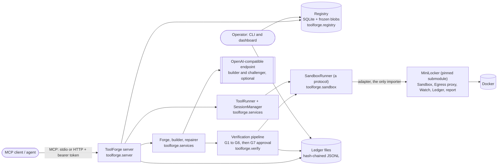
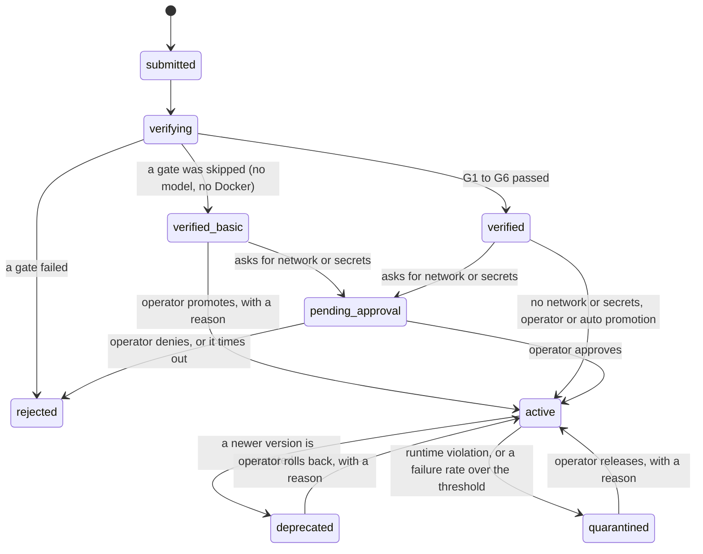

# Architecture

This is the finished picture of ToolForge as the code builds it. The plan that produced it is in `docs/guide/`; where the two differ,
this page and the code are right (`docs/guide/DEVIATIONS.md` lists every difference). Each statement below names the module or the test
that makes it true.

## The pieces



* **Server** (`toolforge.server`): the MCP surface, thin on purpose. The tool list is `META_TOOLS`, defined once in `server/tools.py`;
  `enabled_tools(settings)` says which of them a given server offers (`forge_chain` is optional). Nothing that approves, promotes, releases,
  rolls back or deletes is reachable here: an `ast` test (`tests/test_server_tools.py`) bans the operator functions from the package.
* **Services** (`toolforge.services`): `Forge` (submission, the concurrency limit, resuming a half-verified version), `ToolRunner` (one call),
  `SessionManager` (stateful tools), `Builder` and `Repairer` (the server's own model writing a package), `operator_actions`
  (promote, release, quarantine, roll back, decide), approvals, failure capture and the optional chain runner.
* **Registry** (`toolforge.registry`): the only reader and writer of tool state. Versions are immutable; state changes only through
  `transition`, which knows the one state machine (`registry/lifecycle.py`, shown in `docs/registry.md`).
* **Pipeline** (`toolforge.verify`): each gate is a small class returning `passed`, `failed` or `skipped`. `GATE_INFO` is the one list of gates.
* **Sandbox seam** (`toolforge.sandbox`): the `SandboxRunner` protocol, `FakeRunner` for unit tests and `MiniLockerRunner` for real
  containers. Only `ALLOWED_IMPORTERS` may import MiniLocker, and none at module level (`tests/test_import_boundary.py`).
* **Operator tools**: the `toolforge` command and the dashboard (`toolforge.dashboard`). Both read the same registry as the server and are
  separate processes from it, so an agent has no route to them.
* **Benchmark, attack lab, demo** (`bench/`, `toolforge.attacks`, `demo/`): ways of *measuring* and *showing* the system. They drive the same
  code paths an agent does and add none to the server.

## Trust boundaries

| Zone | Trusted? | Why |
| --- | --- | --- |
| ToolForge host process, registry, pipeline code | yes | Runs on the operator's machine and never runs tool code. |
| The MCP caller (the agent) | no | It may be confused or steered by a hostile page; everything it submits is untrusted. |
| Anything that reaches the MCP port or the dashboard | no | Loopback by default; a bearer token on any other address; `Host` and `Origin` are checked (`toolforge.netguard`). |
| Tool code, tests, manifests, descriptions | no | Written by the caller or by a model. |
| Tool output, test output, sandbox errors | no | Parsed defensively, size-capped, fenced with a random marker and flagged before a model sees them (`server/fences.py`). |
| Builder and challenger model output | no | Data, validated against schemas, never executed on the host. |
| The model provider, if hosted | partly | It receives tool source, tests and samples, never secrets: G1's secret scan and the client's own refusal check run first. |
| **The sandbox container** | the wall | The only security boundary. Static checks are early warnings. |
| The operator | yes | A person who reads the permission diff and decides. |

## A tool's life



Versions are immutable and a name points to at most one `active` version. A skipped gate caps the status at `verified_basic`, and a
version with a skipped gate is never promoted automatically. A version that asks for network hosts or secrets cannot be promoted by hand at
all: it goes through approval (G7), and only a version that was `active` before can be rolled back to.

## The gates

<!-- gates:begin -->
| Gate | Name | Status | What it does | What it catches | Example |
| --- | --- | --- | --- | --- | --- |
| G1 | Static check | built | Reads the tool's files without running anything and looks for risky code, secret-shaped text and hidden instructions. | Network libraries without declared hosts, native-code loaders, keys and tokens left in a file, and descriptions that try to give orders to an AI. It is a quick advisory scan that a determined author can get around; the sandbox is the real boundary. | A tool that imports `socket` but declares no network hosts is rejected before anything runs. |
| G2 | Build | built | Installs the tool's declared dependencies from ready-made wheels only and freezes everything into one sealed file. | Dependencies that cannot be installed without running their setup scripts, versions that do not exist, undeclared dependencies, and packages too big for the sandbox. | A pinned library that only exists as source code has no wheel, so the build fails instead of running its setup script. |
| G3 | Self-tests | built | Runs the tool's own tests and its manifest examples in a sandbox with no network, then checks that the tests really check something. | Tests that fail, examples whose answer is wrong, and tests that would still pass if the tool returned nothing. | A suite made only of `assert True` still passes when the tool returns nothing, so it is rejected. |
| G4 | Schema fuzz | built | Feeds the tool generated inputs that are valid by its own input schema: empty text, long text, zero, big numbers, empty lists. | Crashes, hangs and oversized or non-JSON answers on inputs the schema says are allowed. Refusing with a clear message (`ToolError`) is fine; crashing is not. | A tool that crashes on an empty list fails, with the input that broke it. |
| G5 | Challenger | built | A second AI model, not the one that wrote the tool, tries to break it with inputs the author did not think of. | Mistakes the author's own tests missed. | The challenger finds that the tool miscounts words that contain an apostrophe. |
| G6 | Containment | built | Runs the tool with the network closed and decoy secrets planted (fake keys, an SSH key, an .env file), and watches what it touches. | Reading, printing or copying the decoy credentials, going past the memory, process or CPU limits, changing the container's own files, and a sandbox that is less locked down than it should be. The network is closed for this run, so it cannot show what a tool does with network access; a clean run is evidence, not proof. | A tool that opens `/tmp/.aws/credentials` is caught by the decoy planted there. |
| G7 | Approval | built | A human operator decides on tools that ask for network access or secrets. | Permissions nobody agreed to. | A tool that asks to call `api.example.org` waits until the operator approves exactly that host. |
<!-- gates:end -->

Every gate writes to the version's hash-chained ledger. A gate that cannot run is `skipped`, never `passed`, and the report says why.

## One call

1. Resolve the name to its active version (or the pinned one) and check its status and, for a session tool, the session's rules.
2. Open a fresh sandbox from the runtime image with the manifest's limits and network rule. Network and secrets need a recorded approval for
   exactly this code hash; a development run gets neither.
3. Restore the frozen package into `/workspace`, write the input, run the harness, and read the result envelope under a size cap.
4. Fence the output, record the statistics, check the decoy tripwire, close the sandbox, write the call events.
5. A call that touched a decoy fails with `PolicyViolation` and quarantines the active version until an operator releases it.

## Where things are stored

```
$TOOLFORGE_HOME/                      default ~/.toolforge (the compose file uses /data)
  registry.sqlite3                    versions, status, gate results, calls, approvals, sessions, search index
  blobs/<sha256>.tar.gz               frozen tool packages
  ledgers/<tool>@<version>/           verify-<run>.jsonl, operator.jsonl, one file per sandbox, sessions/<id>.jsonl, blast-radius.json
  ledgers/_builds, _repairs, chains/  builder, repair and chain events (ids, hashes and counts only)
  approvals/<id>.json                 approval requests
  keys/                               the signing key, only after `toolforge keys init` (mode 0600)
runs/                                 results written by `toolforge attacks`, `python -m bench` and `demo/run_demo.py` (git-ignored)
```

Ledger payloads hold ids, hashes, counts and labels, never a secret value, an argument, a result or source text.

## What MiniLocker contributes, and where the seam is

ToolForge uses MiniLocker for the one job it does best: running untrusted code and proving what it did. It uses `Sandbox` (hardened containers
with no route out, read-only root, dropped capabilities, limits), `EgressManager` (the allowlisting proxy and the credential broker), `Watch`
(decoy credentials and the audit), `Ledger` (the hash chain), the report builder behind Blast Radius, and snapshot capture and restore. It
does not use MiniLocker's agent loop, HTTP control plane, shell policy engine, scenarios, artifact store or interface.

MiniLocker is a pinned git submodule that is never copied. `sandbox/_ml_path.py` puts its `backend/` directory on `sys.path` in one place and turns
a missing checkout, a missing `docker` package or a broken install into one `SandboxUnavailable` with advice. The details, the
limits that come with it, and the commit are in `docs/guide/03-minilocker-integration.md`.

## Running it as containers

`docker-compose.yml` runs the server and the dashboard from one image (`deploy/Dockerfile`). Neither mounts the Docker socket: they reach the daemon
through a socket proxy that allows only the Docker API families MiniLocker calls, and sandboxes are siblings of these containers, not children. The
same image runs the egress proxy (`TOOLFORGE_EGRESS_PROXY_IMAGE`), because a file bind-mounted from inside a container would name a path that does not
exist on the Docker host. Both listeners publish on `127.0.0.1` only and need their bearer tokens from `.env`. Setup is in `docs/clients.md`.
This arrangement has not been run on a real daemon where it was written; see `docs/KNOWN_LIMITATIONS.md` and `PROGRESS.md`.
