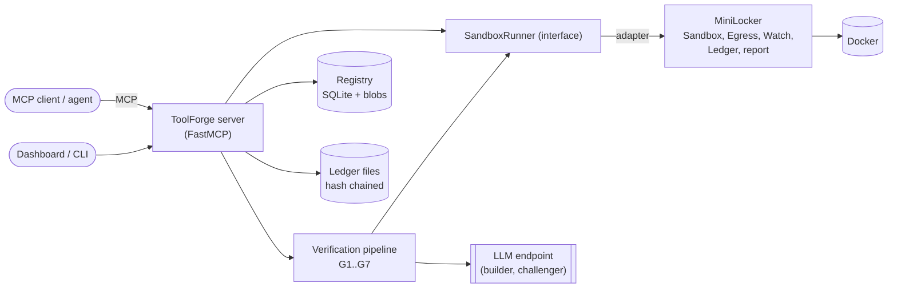
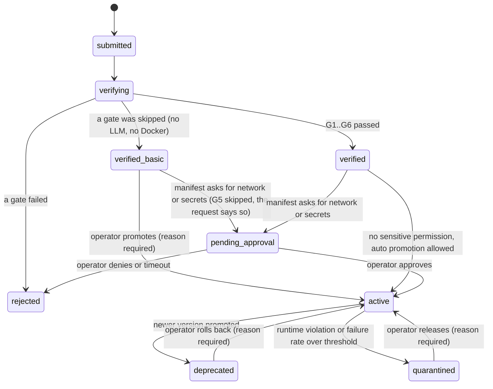

# Architecture

## Components



* **Server** (`toolforge.server`): the MCP surface. Thin. It validates input, calls services, shapes results.
* **Services** (`toolforge.core`): `Forge` (submit/build/repair), `Runner` (execute a tool), `Approvals`, `Search`.
* **Registry** (`toolforge.registry`): the only place that reads or writes tool state.
* **Pipeline** (`toolforge.verify`): the gates, each a small class with a uniform result type.
* **Sandbox seam** (`toolforge.sandbox`): `SandboxRunner` protocol, `FakeRunner`, `MiniLockerRunner`.
* **LLM** (`toolforge.llm`): an OpenAI-compatible client with separate builder and challenger configurations. It rate-limits
  itself and backs off on HTTP 429. Use different models for builder and challenger on purpose (`04-optional-resources.md`).
* **Website** (`site/`, `scripts/`): a static site generated from the same constants and result files the code uses. It is
  documentation, not part of the runtime.

## Trust boundaries

| Zone | Trusted? | Notes |
| --- | --- | --- |
| ToolForge host process, registry, pipeline code | yes | Runs on the operator's machine. |
| The MCP caller (the agent) | no | May be confused or manipulated by a hostile page. Its submissions are untrusted. |
| Other processes and network peers reaching the MCP HTTP port or the dashboard | no | Loopback by default; a bearer token is required on any other host; `Origin` and `Host` are checked (P07, P17). |
| Tool code, tests, manifests, descriptions | no | Authored by the caller or the builder LLM. |
| Tool outputs and test output | no | Parsed defensively, size capped, fenced before a model sees them. |
| Challenger and builder LLM outputs | no | Data, validated against schemas, never executed on the host. |
| The LLM provider (if hosted) | partly | Receives tool source, tests and samples. Never receives secrets (G1 scans for them). See `04-optional-resources.md`. |
| Sandbox container | the wall | The only security boundary. Static checks are early warnings. |
| Operator (approvals, promote, release, rollback) | yes | A human who reads the permission diff before approving. |

## Tool lifecycle

Versions are immutable. A tool name points to at most one `active` version.



Gate results are `passed`, `failed`, or `skipped` (could not run). A tool with any `skipped` gate stops at `verified_basic`
and is never promoted automatically; the operator can promote it by hand with `toolforge promote` and a recorded reason. A
manifest with network hosts or secrets cannot be promoted that way: it must go through approval (G7), which is open to a
`verified_basic` version too, so the no-key path works for network tools. The approval request names every skipped gate.
Only a version that was `active` before can be rolled back to, which guarantees it already passed every gate and approval.

## Gates

| Gate | Name | What it checks |
| --- | --- | --- |
| G1 | static | manifest schema, name rules, size caps, syntax, import/permission consistency, secret-shaped strings, description scan |
| G2 | build | installs pinned requirements in a build sandbox, freezes the package blob and its hash |
| G3 | self-tests | the author's tests pass in a no-network sandbox, and are shown to constrain behaviour |
| G4 | fuzz | inputs generated from the schema never crash the tool unhandled, outputs stay bounded and JSON |
| G5 | challenger | an independent model writes extra adversarial cases and reviews permissions; they must pass |
| G6 | containment | run with decoys planted; no decoy touched, no undeclared egress, no writes outside workspace |
| G7 | approval | an operator approves tools that ask for network hosts or secrets |

The code keeps this list once, as `GATE_INFO` (P06). Docs and the site read it.

## Calls

1. Resolve `name` to the active version (or the pinned one).
2. Check status (`active`, not quarantined), check session rules.
3. Fresh sandbox from the runtime image with the manifest's limits and network rule.
4. Restore the frozen package into `/workspace`, write the input, run the harness, capture output (capped).
5. Parse the result envelope, fence the output text, record stats, close the sandbox, write the call events.

## Event catalogue (extend in each patch)

`forge.submitted`, `forge.verifying`, `forge.gate.started`, `forge.gate.passed`, `forge.gate.failed`, `forge.gate.skipped`,
`forge.verified`, `forge.rejected`, `forge.approval.requested`, `forge.approval.granted`, `forge.approval.denied`, `forge.promoted`,
`forge.deprecated`, `forge.quarantined`, `forge.released`, `forge.call.started`, `forge.call.finished`,
`forge.build.finished`, `forge.session.opened`, `forge.session.step`, `forge.session.rewound`, `forge.session.closed`,
`forge.repaired`, `forge.rolled_back`, `forge.verification.aborted`, `forge.chain.started`, `forge.chain.finished` (optional, S02). MiniLocker-native events from `Watch` and the sandbox are kept as is.

### Repair and rollback events (P12)

`forge.repaired`: one file per attempt, `ledgers/_repairs/<repair id>.jsonl`, actor `repair`. Payload: `repair_id`, `tool`, `parent` and
`child` (versions), `child_status`, `outcome` (`verified`, `failed`, `aborted`), `stop_reason`, `source` (`model` or `caller`), `rounds`,
`regression_cases` (how many stored inputs the child was run against), `problem_sha256` and `problem_chars` (the problem text itself is
never written), `model`, `requests`, `tokens_in`, `tokens_out`, `wall_time_ms`.

`forge.rolled_back`: written by `toolforge rollback` to the restored version's `operator.jsonl`, actor `operator`, with the reason and
the versions it replaced (each of those hears `forge.deprecated`).

An automatic quarantine is the existing `forge.quarantined`, actor `forge`, with the failure counts as its reason.

### Verification events (P06)

One ledger file per run, `ledgers/<tool>@<version>/verify-<run id>.jsonl`. `forge.submitted` carries the `code_sha`, who submitted, a
summary of the declared permissions, the run id and whether the run resumed an earlier one. `forge.verifying`, `forge.verified` and
`forge.rejected` are the lifecycle moves. Each gate writes `forge.gate.started` and then `forge.gate.passed`, `forge.gate.failed` or
`forge.gate.skipped` with its summary and numbers. `forge.verification.aborted` means the sandbox was unavailable: the version stays
`verifying` and the same submission resumes it. Hashes, counts and labels only; never source text, secret matches or sandbox output.

G5 (P10) adds no event type. Its `forge.gate.*` event carries `metrics`: the challenger's `model` id, `tokens_in` and `tokens_out` (null when the provider gave none),
`latency_ms`, `requests`, and the case counts `cases_proposed`, `cases_usable`, `cases_dropped`, `host_cases`, `cases_executed`, `cases_failed` and `cases_warned`. The prompt, the code
and the model's text are never written to a ledger.

### Operator events (P07)

`toolforge promote` writes `forge.promoted` (with the operator's reason) to `ledgers/<tool>@<version>/operator.jsonl`, and `forge.deprecated` to the
same file of the version that the promotion replaced. The actor is `operator`. Later operator commands (release, quarantine, rollback) use the same
file.

### Containment and Blast Radius events (P08)

`toolforge quarantine` writes `forge.quarantined` and `toolforge release` writes `forge.released` (both with the operator's reason, actor
`operator`) to the version's `operator.jsonl`; releasing also writes `forge.deprecated` to a sibling it displaced. The runtime tripwire writes
`forge.quarantined` there too, with actor `forge`, the call id and the decoy labels, when a real call touches a decoy. G6 writes no event of its own
beyond the usual `forge.gate.*` ones; the pipeline adds a Blast Radius report next to the ledgers, `blast-radius.json` (`report/blast_radius.py`).
G6 runs with the network closed, so "no undeclared egress" in the table above is not measured by it; P09 measures it on real calls (below).

### Approval events (P09)

A verified version that asks for network hosts or secrets moves to `pending_approval` and the pipeline writes `forge.approval.requested` to the
verification ledger (with `approval_id`, the requested permissions, the skipped gates and the expiry). The request ends in one of three
ways, each written to the version's `operator.jsonl`: `forge.approval.granted` (actor `operator`, with the reason), or
`forge.approval.denied` (actor `operator` with the reason; actor `forge` for a timeout, a failed live example, or a brokered secret with no
broker service; the payload says which). `toolforge approvals` is the only way to grant or deny; no MCP tool can.
`forge.call.started` carries `network` (`none` or the declared hosts) and `secrets` (the declared service names), and `forge.call.finished`
carries `real_secret_audit` (`clean`, `found` or `not_measured`). See `docs/approvals.md`.

### Call events (P05)

Each call writes `forge.call.started` before its sandbox exists and `forge.call.finished` after it is gone, to
`ledgers/<tool>@<version>/<call-id>.jsonl` (`ledgers/_dev/...` for `--dev-unverified`); the sandbox's own events go to the same chain
while it is open. `started` carries the call id, tool label, `code_sha`, the SHA-256 and size of the arguments, the number and size
of files, the limits and the network rule. `finished` carries `ok`, the error type, the host-measured `duration_ms`, `truncated`,
`sandbox_timed_out`, `result_bytes` and the audit summary (`cleanup_ok`, `egress_attempts`, `decoy_events`, `real_secret_audit`). Argument values, file
names, results and output text never enter the ledger. A call that cannot write `started` does not run.

## Directory layout at the end

```
src/toolforge/
  __init__.py  cli.py  config.py  errors.py
  models/       package.py  results.py  events.py
  registry/     db.py  store.py  search.py  lifecycle.py
  sandbox/      base.py  fake.py  minilocker_runner.py  harness.py  assets/harness.py  images.py
  sdk.py        (written into every sandbox as toolforge_sdk.py)
  verify/       pipeline.py  g1_static.py  g2_build.py  g3_selftest.py  g4_fuzz.py  g5_challenger.py  g6_containment.py
  services/     runner.py  forge.py  approvals.py  sessions.py  repair.py  builder.py  chain.py (optional, S02)
  llm/          client.py  prompts/
  server/       app.py  tools.py  fences.py  signature.py  budget.py   (signature and budget: P12)
  report/       blast_radius.py
  adapters/     recipes/  (markdown recipes the agent can fetch)
  attacks/      catalog.py  runner.py
  dashboard/    app.py  static/
  provenance/   keys.py  attest.py  bundle.py     (optional, S01)
tests/  examples/toolpacks/  bench/  demo/  third_party/minilocker/  docs/
site/  scripts/                                  (the website, P19 and P20)
```
